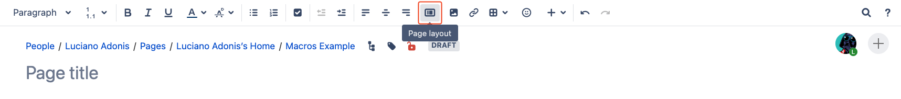
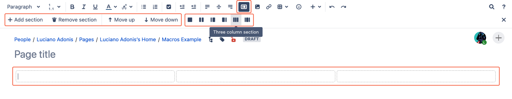
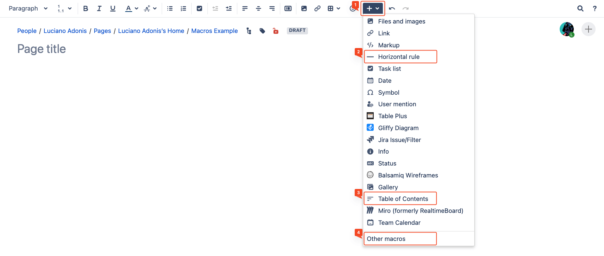
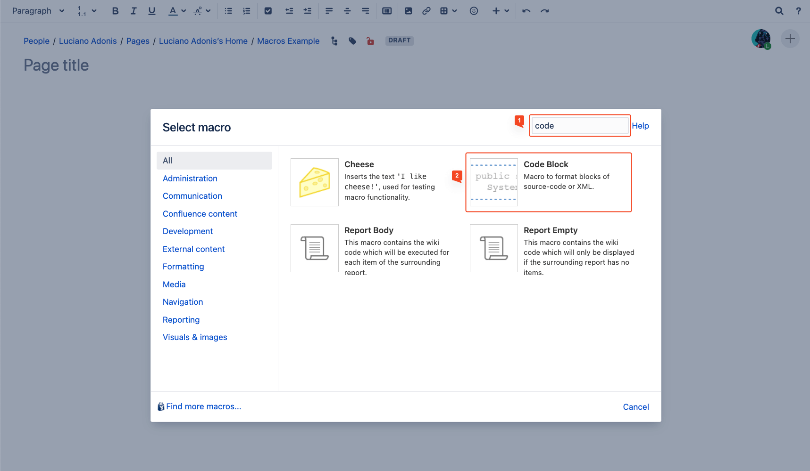
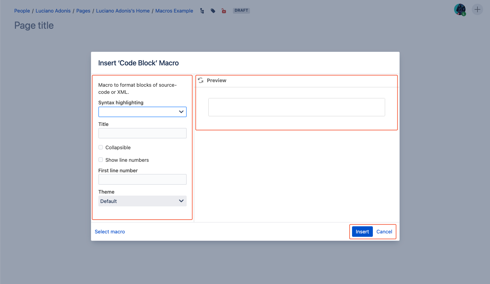

## Getting Started

In this chapter, we'll cover the basics to help you:

- Learn the sad difference between Cloud and Data Center versions.
- Understand how pages are organized.
- Get familiar with the Layout feature.
- Explore how to use Macros effectively.
- Search in Confluence.

With these foundations in place, we'll be ready to dive into the real fun.

### Cloud is Not the Same as Data Center

If you've heard about a cool new feature in Confluence but are using the Data Center version, chances are even if you're lucky, you won't see it soon.

One feature not available at the time of writing is the ability to change a page's owner. The user who creates the page is the owner, while others who edit or update it appear in the history as the last person to make changes to the page. There is no way to replace the owner other than recreate the document.

Now, imagine that you search for information, find a document, and have questions about it. Naturally, you'd reach out to the original author, but guess what? They don't work at the company anymore.

That feature is convenient, especially in teams with high rotation. It prevents you from being unnecessarily contacted about something you're no longer responsible for or from having to act as a go-between to the correct person.

There are workarounds, like using a macro to make people who have edited the document appear as contributors at the end of the page, which we'll cover later in the advanced topics.

This difference extends beyond features: integrations, performance improvements, and even the user interface can differ. Cloud gets more frequent updates, while Data Center tends to fall behind to be more stable.

### Page Distribution

When you create a new page, it will automatically be nested under **the page you were viewing** when you pressed the "Create" button. If you want your new page to be a child of a specific parent page, you must navigate to that page before creating it.

It's a common mistake that people often create pages without realizing where they are at the top level of the space, which can lead to drafts floating around at the top level. Not a huge problem, but it can make things messy very quickly.

To keep your space organized, double-check your location before you create a page. It's a quick step that can save you from having to clean up later.

You can also create pages in your personal space.

#### Cloud Differences

The Cloud version allows you to quickly add new pages directly from the side menu rather than relying solely on the "Create" button.

<video class="clip" controls muted loop playsinline preload="none" width="592" height="628" poster="/media/confluence/basics-cloud-page-creation.jpg" aria-label="Cloud sidebar with the page tree (Platforms, Guilds, Finance, Team Information, About Confluence, POCs) and a Create button at the bottom"><source src="/media/confluence/basics-cloud-page-creation.mp4" type="video/mp4"></video>

Even though I was initially on the "Team Information" page, because I clicked the button to create a page from the "POCs" page, the new page was created, and I was automatically moved to the empty page under "POCs".

### Layouts

The Layout settings are often overlooked, as you can only see the menu after clicking the button highlighted in red:

The first time you click this button, it will add existing content to a single section. If you have a lot of content, there isn't a way around it; you must add more sections and separate them manually.

From left to right:
1. This first section will allow you to include rows, by default when you add a new one, this will be placed below the one that you are currently placed.
2. This section will allow you to set the distribution of the section row.

#### Cloud Differences

The base layout doesn't cover the entire page but applies to just one section, and you can add more as needed. The options remain the same, though it's likely designed this way to be more responsive.

### Macros

The magic behind Confluence.

1. The plus button will open the menu where we can see standard macros.
2. Horizontal rule
3. Table of Contents.
4. Other macros: this last one will display the menu with the rest of the available macros installed.

For the following example we are going to search for the Code Block macro.

1. Using the search menu you can filter the results.
2. Click the macro.

For most macros, if not all, clicking it will open an insert menu for customization. Don't worry, you can always return to this menu by clicking 'edit' on the macro.

Things to make clear about this section are:

The options will depend on the macro, but they are worth checking. In some cases, they are a bit complex and may require additional knowledge.
- The preview menu lets you see how your changes will be reflected.

In most cases, you will first need to include content to appreciate how it changes, so in the next section, we will do that.

<video class="clip" controls muted loop playsinline preload="none" width="760" height="456" poster="/media/confluence/basics-macro-customization.jpg" aria-label="Animation of a Code Block macro on an editor page, a title bar over a box with the text echo hi"><source src="/media/confluence/basics-macro-customization.mp4" type="video/mp4"></video>

For this example, we are setting properties.

- Those will be reflected after the macro name.

### Search

It's not a skill issue, it really sucks. But there are ways to get better results.

When using the search keep in mind the following:
  - Limit the scope:
    - Filter by Space
    - Filter by User
  - Add tags:

Most of these little improvements can be optimized.

### Permissions

[Pending to add... explain certain limitations to take actions.]

---
