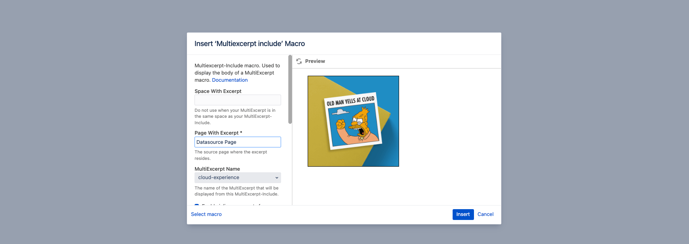
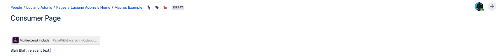

## Datasource Pages

Just like it sounds, a Datasource Page is where you consolidate information. With Macros like [Multiexcerpt](https://confluence.atlassian.com/conf719/excerpt-macro-1157466743.html) and [Table Include](https://docs.stiltsoft.com/tfac/dc-server/how-to-use-table-excerpt-and-table-excerpt-include-macros-42241623.html), you can save yourself a ton of headaches by keeping your source of truth and attached pages in sync.

If you ever change the name or something on the datasource page, it won’t break the pages that depend on it—it updates automatically. So go ahead, get creative!

### Structure

### Example
The reusable content can be anything that you can place in that box, so be either text or image it can be there. Of course, with the exception of tables which have their own macro to do that.

To include something you have to use the multiexcerpt include macro which will display you the available options in the page and a small preview of the content retrieved:

From the edition menu will look like this:

## Tagging

[Live Search](https://confluence.atlassian.com/conf719/livesearch-macro-1157466803.html) gets even better when you’re using proper tagging, so take the time to tag your content wisely.

[Go to Types of Pages](#types-of-pages) for more inspiration.

## Security & Limitations

Not much to say, just to complain.

- There are not granular controls over the documentation by default. Basically an exclusive list or allow all. There is a solution sold by Confluence to have more visibility over everything for each type of implementation:
  - [Crowd (Data Center)](https://www.atlassian.com/software/crowd).
  - [Guard (Cloud)](https://www.atlassian.com/software/access/capabilities).
- Someone could dump everything.
- Page Ownership is only available in Cloud Version.

## References

There isn't much from Confluence but there are a few sources that are worth looking:

- That YouTube Channel.
- Stuff.

---
