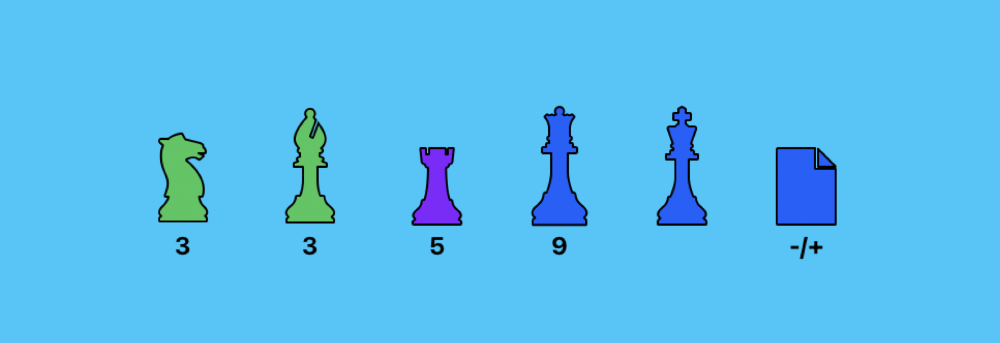

<!--- https://darksouls.wiki.fextralife.com/Character+Information --->

---

---

This chapter is still being written. The sections below are short notes, not the full thing.

## Board Expectations

<!-- source: 2026 batch (8126bde), restored -->
Every manager wants strong pieces, but you work with what the board gives you.

Even with strong pieces, the question is whether you're playing them where their value is.

<!-- source: 2026 batch (8126bde), restored -->
A queen played as a pawn isn't a waste you notice right away. The board might look balanced and the piece sits in a safe square. But you're getting pawn output from a queen, and somewhere else there's a gap a queen could have filled.

### Matching

A high Power, low Versatility engineer shouldn't own cross-team coordination. A high Foresight, high Insight person shouldn't be buried in tickets with no say over direction.

Two engineers with the same seniority and stack can have totally different profiles: one goes deep and needs stability, the other moves fast and needs variety. Treat them as interchangeable and you get worse results than treating them as different pieces with different best squares.

<!-- source: 2026 batch (8126bde), restored -->
Good matching means knowing your pieces well enough to do more than read their title. In that example one is a specialist and the other a generalist.

Matching also means covering. A junior next to a strong senior can take work beyond their level because the senior backstops the hard decisions.

### Short Term Solutions

Buying time without making the long term worse.

Pulling a strong piece over to stabilize an area works once. Do it again and again and you get two problems: the original gap and a dependency on that piece to keep jumping between fires.

Temporary coverage, pairing and scope reduction are fair tools.

<!-- source: 2026 batch (8126bde), restored -->
The trap is treating them as permanent without admitting what they cost. Every piece playing out of position leaves something uncovered or underperforming, so those decisions pile up.

### Long Term Solutions

<!-- source: 2026 batch (8126bde), restored -->
Long term solutions mean investing in the dimensions that are weak across your whole team, instead of compensating around them every time.

If Range is always the gap that blocks you, don't find one person with high Range and route every cross-cutting problem to them. They become a bottleneck and then a flight risk. Grow Range across the team.

Some squares can't be filled from the inside in a useful time.

<!-- source: 2026 batch (8126bde), restored -->
Knowing when to hire for a specific dimension gap, instead of hiring the strongest generalist and hoping they cover it, is one of the harder calls.

### Invest in Potential

A piece with high potential and uneven dimensions can be worth more than one with moderate development everywhere, given time, investment and a senior covering while it grows.

Pick the dimensions that block them from the next level, and check that your project can actually develop them. A Reactive project grows Speed and some Versatility. A long Improvement project grows Insight and Range.

### How Innovation Looks

Innovation usually looks like a piece with enough Foresight to see a problem coming and enough Range to propose something that works in more than one context.

A team in permanent firefighting doesn't get there: all attention is on the present, and Speed and Power take over while the rest fade. It can't anticipate, and it doesn't develop Range, because every solution gets optimized for the immediate problem.

---
