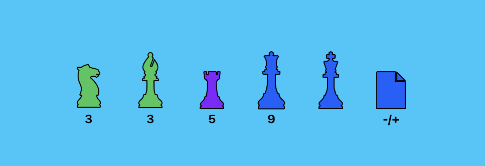

<!--- https://darksouls.wiki.fextralife.com/Character+Information --->

---

---

## Chess

[How Chess Can Make You Better At Business](https://www.chess.com/article/view/how-chess-can-make-you-better-at-business)
[What Chess Can Teach Us About Entrepreneurship](https://www.forbes.com/councils/forbesbusinesscouncil/2024/05/02/what-chess-can-teach-us-about-entrepreneurship/)
[Business is Like Chess](https://salvadorbriggman.com/business-like-chess/)

---
